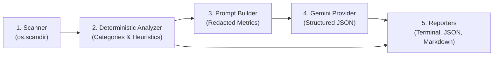

# Agent Development Guidelines (AGENTS.md)

This file defines the operational contract and development standards for AI coding agents working on **AI Disk Analyzer**.

> **MANDATORY**: Before proposing or making changes, read the workspace rule files in `.agents/rules/`:
> - [`.agents/rules/project-architecture.md`](file://.agents/rules/project-architecture.md)
> - [`.agents/rules/python-quality.md`](file://.agents/rules/python-quality.md)
> - [`.agents/rules/security-privacy.md`](file://.agents/rules/security-privacy.md)
> - [`.agents/rules/testing-workflow.md`](file://.agents/rules/testing-workflow.md)

---

## 1. Project Purpose & Scope

AI Disk Analyzer is a Linux-first CLI utility designed to:
- Scan filesystem directories safely and efficiently.
- Calculate logical and allocated disk space metrics.
- Identify large files, large directories, and storage patterns (caches, build artifacts, virtualenvs, etc.) deterministically.
- Generate natural-language explanations and advice using Google Gemini API (`gemini-3.8-flash`).
- Render terminal reports with Rich and export structured reports to JSON and Markdown.
- **NEVER** delete, move, or modify user files.

---

## 2. Technology Stack

- **Runtime**: Python 3.11+
- **CLI Framework**: Typer
- **Terminal UI**: Rich
- **LLM SDK**: Official `google-genai` SDK (`from google import genai`)
- **Default Model**: `gemini-3.8-flash`
- **Data Validation**: Pydantic v2
- **Configuration**: PyYAML, python-dotenv
- **Testing**: pytest, pytest-cov
- **Linting & Formatting**: Ruff
- **Build System**: setuptools via `pyproject.toml`

**Disallowed Technologies**: Do NOT introduce Ollama, local LLM runtimes, web frameworks, GUI frameworks, or external databases.

---

## 3. Architecture & Data Flow



1. **Filesystem Traversal (`disk_analyzer.scanner`)**: Recursively collects file metadata, computes logical size (`st_size`) and allocated space (`st_blocks * 512`), deduplicates hard links `(st_dev, st_ino)`, avoids symlink loops, catches permission errors gracefully into `ScanDiagnostic`, and outputs `ScanResult`.
2. **Deterministic Analysis (`disk_analyzer.analysis`)**: Aggregates extension distributions, categorizes storage patterns, estimates volume usage via `shutil.disk_usage`, and creates evidence-based recommendations. Operates completely offline.
3. **AI Enhancement (`disk_analyzer.ai`)**: Sanitizes metadata, redacts paths, submits structured prompt to `gemini-3.8-flash`, and validates output against `AISummary`. Gracefully falls back to deterministic analysis if API key is absent or network fails.
4. **Reporting (`disk_analyzer.reporting`)**: Renders consistent data across Rich terminal tables, machine-readable JSON, and GitHub-Flavored Markdown.

---

## 4. Coding & Security Rules

1. **Zero Secret Exposure**: Never hardcode, commit, print, or log real Gemini API keys. Keys must only be read from `GEMINI_API_KEY`. Displayed configs must mask keys (`mask_secret()`).
2. **Read-Only Invariant**: Scanning is strictly non-destructive. Never implement file deletion, permission modifications, or automatic cleanup commands.
3. **No Command Execution**: Never execute shell commands recommended by the AI. Treat AI outputs and file names as untrusted input.
4. **Privacy Minimization**: Never read file contents. Redact `/home/<user>` to `~` by default before sending data to Gemini.
5. **No Placeholders**: Never leave required features as empty `pass` statements, pseudocode, or TODO stubs.

---

## 5. Testing & Verification Requirements

Run tests and lint checks after any meaningful code change:

```bash
# Run full test suite with coverage
.venv/bin/pytest

# Run Ruff linting and formatting checks
.venv/bin/ruff check src tests
.venv/bin/ruff format --check src tests
```

- Tests must use `tmp_path` synthetic fixtures and mocked Gemini SDK calls.
- Never make live network requests to Google during automated tests.
- Report real test and coverage numbers without fabricating results.

---

## 6. Definition of Done for Future Tasks

A task is complete only when:
1. All changes adhere to `.agents/rules/*.md`.
2. All unit and integration tests pass cleanly with pytest.
3. Ruff linting and format checks pass with zero errors.
4. Documentation is updated to match any behavioral or interface changes.
5. Git working directory remains clean of untracked secrets, caches, or build artifacts.

