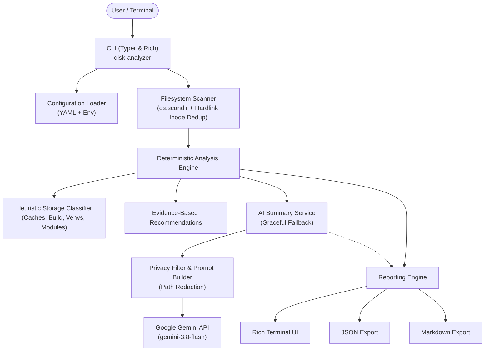

# AI Disk Analyzer

An intelligent, privacy-preserving disk space analysis utility for Linux powered by deterministic filesystem scanning and Google Gemini AI.

[](https://github.com/example/ai-disk-analyzer/actions)
[](LICENSE)
[](https://www.python.org/)

---

## Overview

**AI Disk Analyzer** (`disk-analyzer`) helps Linux developers and system administrators understand storage consumption without compromising system safety or privacy. It combines high-performance recursive filesystem inspection with intelligent natural-language summaries from Google Gemini.

### Key Objectives & Principles:
- **Deterministic First**: Core scanning, size aggregation, and storage categorization work 100% offline without requiring Gemini.
- **Strictly Read-Only**: Diagnoses disk usage without deleting, modifying, or executing commands on your system.
- **Privacy-Preserving**: Only transmits aggregated, redacted statistics to Gemini—never reads file contents or exposes usernames.
- **Accurate Space Accounting**: Accurately differentiates logical file sizes (`st_size`) from allocated disk blocks (`st_blocks * 512`) and deduplicates hard links to prevent double-counting.

---

## Architecture



---

## Features

- **Recursive Traversal**: Fast directory inspection utilizing `os.scandir`.
- **Hardlink Deduplication**: Inode tracking `(st_dev, st_ino)` prevents double-counting allocated disk blocks across hardlinks.
- **Symlink Protection**: Symlinks are un-followed by default (`follow_symlinks=False`); cycle detection prevents infinite loops if enabled.
- **Pattern Categorization**: Automatically identifies user caches (`~/.cache`), Node.js modules (`node_modules`), Python virtualenvs (`.venv`), compiler outputs (`target/`, `build/`, `dist/`), desktop trash (`.local/share/Trash`), package caches (npm, pip, cargo, gradle), and logs.
- **Evidence-Based Recommendations**: Highlights cleanup candidates with explicit risks, precautions, and estimated potential savings.
- **Google Gemini Integration**: Uses the official `google-genai` SDK and model `gemini-3.8-flash` to generate natural-language explanations and prioritized next steps.
- **Offline / No-AI Mode**: Fully functional with `--no-ai` or when API keys are absent.
- **Multi-Format Export**: Renders stylized terminal reports with Rich, or exports machine-readable JSON and GitHub-Flavored Markdown.

---

## Target Platforms

- **Arch Linux & Arch Derivatives** (including CachyOS, EndeavourOS, Manjaro)
- **Ubuntu & Debian Derivatives**
- **Fedora, RHEL, and other POSIX-compliant Linux distributions**
- Python 3.11 or newer

---

## Installation

### Standard Virtual Environment Workflow

```bash
# Clone repository
git clone https://github.com/example/ai-disk-analyzer.git
cd ai-disk-analyzer

# Create virtual environment
python3 -m venv .venv
source .venv/bin/activate

# Upgrade pip and install package
python -m pip install --upgrade pip
python -m pip install -e ".[dev]"
```

Verify installation:
```bash
disk-analyzer --help
disk-analyzer --version
```

---

## Gemini API Configuration

1. Obtain a free API key from [Google AI Studio](https://aistudio.google.com/).
2. Export the environment variable or create a `.env` file:

```bash
# Method A: Export environment variable
export GEMINI_API_KEY="AIzaSyYourSecretKeyHere"

# Method B: Use a local .env file (automatically loaded)
cp .env.example .env
# Edit .env and insert your GEMINI_API_KEY
```

3. Verify connectivity:
```bash
disk-analyzer check-ai
```

### Environment Variables Reference

| Variable | Default | Description |
| :--- | :--- | :--- |
| `GEMINI_API_KEY` | *(None)* | Google Gemini API Key |
| `GEMINI_MODEL` | `gemini-3.8-flash` | Gemini model ID |
| `GEMINI_TIMEOUT_SECONDS` | `60` | HTTP request timeout in seconds |
| `GEMINI_MAX_RETRIES` | `2` | Retry attempts for transient rate limits or 5xx errors |

---

## CLI Usage

### Basic Scan (with AI Summary)
```bash
disk-analyzer scan ~/
```

### Offline / No-AI Scan
```bash
disk-analyzer scan ~/ --no-ai
```

### Export to Machine-Readable JSON
```bash
disk-analyzer scan ~/projects --format json --output report.json
```

### Export to Markdown
```bash
disk-analyzer scan ~/projects --format markdown --output report.md
```

### Inspect Configuration
```bash
disk-analyzer config
```
*(Sensitive API keys are always masked in output)*

### Advanced Scan Flags

```bash
disk-analyzer scan /target/directory \
  --top 20 \
  --max-depth 3 \
  --exclude "**/.git/**" \
  --exclude "**/node_modules/**" \
  --overwrite \
  --no-redact-paths
```

---

## Example Output *(Illustrative)*

```text
╭──────────────────────────────────────────────────────────────────────────────╮
│ AI Disk Analyzer v0.1.0                                                      │
│ Scan Root: ~/projects/demo                                                   │
╰──────────────────────────────────────────────────────────────────────────────╯
╭───────────────────────── Filesystem Volume Capacity ─────────────────────────╮
│ Total Capacity: 465.76 GiB   Used Space: 280.40 GiB (60.2%)   Available Space: 185.36 GiB │
╰──────────────────────────────────────────────────────────────────────────────╯
                                  Scan Summary                                  
      Scanned Files    Scanned Directories    Logical Size    Allocated Size    Duration    Diagnostics
 ━━━━━━━━━━━━━━━━━━━━━━━━━━━━━━━━━━━━━━━━━━━━━━━━━━━━━━━━━━━━━━━━━━━━━━━━━━━━━━━━━━━━━━━━━━━━━━━━━━━
             14,280                  1,412        4.82 GiB          5.10 GiB       1.24s              0

                           Top Largest Directories
╭──────┬──────────────────────────────────────────┬───────────┬────────┬────────╮
│    # │ Directory Path                           │      Size │  Files │ % Scan │
├──────┼──────────────────────────────────────────┼───────────┼────────┼────────┤
│    1 │ ~/projects/demo                          │  4.82 GiB │ 14,280 │ 100.0% │
│    2 │ ~/projects/demo/web/node_modules         │  1.85 GiB │  8,120 │  38.4% │
│    3 │ ~/projects/demo/backend/target           │  1.20 GiB │  1,420 │  24.9% │
│    4 │ ~/projects/demo/.venv                    │ 450.0 MiB │  2,890 │   9.1% │
╰──────┴──────────────────────────────────────────┴───────────┴────────┴────────╯

                     Storage Pattern Breakdown (Heuristic)
╭────────────────────────────────────────┬───────────┬─────────┬───────┬────────────┬─────────────────╮
│ Category                               │      Size │ % Total │ Files │ Confidence │ Cleanup Candidate?│
├────────────────────────────────────────┼───────────┼─────────┼───────┼────────────┼─────────────────┤
│ Node.js Dependencies (node_modules)    │  1.85 GiB │   38.4% │ 8,120 │    high    │       Yes       │
│ Build Artifacts & Compiled Output      │  1.20 GiB │   24.9% │ 1,420 │    high    │       Yes       │
│ Python Virtual Environments            │ 450.0 MiB │    9.1% │ 2,890 │    high    │       Yes       │
╰────────────────────────────────────────┴───────────┴─────────┴───────┴────────────┴─────────────────╯

═══ Deterministic Recommendations ═══
╭──────────────────────────────────────────────────────────────────────────────╮
│ [MEDIUM] Clean compilation and build output directories (1.20 GiB)           │
│ Compiler outputs, target binaries, and dist bundles consume 1.20 GiB.        │
│ • Potential Reclaimable: 1.08 GiB (Confidence: high)                         │
│ • Risks & Precautions: Next build will require a clean recompilation.         │
│ • Suggested Actions:                                                         │
│     - Run clean targets: 'cargo clean' in Rust or remove 'dist/' in web apps.│
╰──────────────────────────────────────────────────────────────────────────────╯

╭─────────────────── Google Gemini AI Intelligent Assessment ───────────────────╮
│ Executive Summary:                                                           │
│ Storage is heavily dominated by transient build trees and JavaScript modules.│
│                                                                              │
│ Main Storage Consumers:                                                      │
│   • ~/projects/demo/web/node_modules accounts for 38% of total scanned space.│
│   • ~/projects/demo/backend/target compiler output accounts for 25%.         │
│                                                                              │
│ Potential Cleanup Candidates:                                                │
│   • Prune build artifacts in backend/target using 'cargo clean'.             │
│   • Evaluate whether inactive frontend experiments can be cleaned.          │
│                                                                              │
│ Prioritized Next Steps:                                                      │
│   1. Run 'cargo clean' in backend projects if not currently debugging.       │
│   2. Inspect unused node_modules trees.                                      │
╰──────────────────────────────────────────────────────────────────────────────╯
```

---

## Configuration File Reference

Create `config.yaml` to specify default behavior:

```yaml
general:
  top_items: 15
  max_depth: null
  follow_symlinks: false
  quiet: false

scanner:
  exclude:
    - "**/.git/**"
    - "**/__pycache__/**"
    - "**/node_modules/**"
  exclude_system_virtual_fs: true

analysis:
  classify_storage: true
  top_extensions_count: 10
  estimate_reclaimable: true

ai:
  enabled: true
  model: "gemini-3.8-flash"
  timeout_seconds: 60
  max_retries: 2

reporting:
  redact_paths: true
  default_format: "terminal"
```

---

## Safety & Privacy Guarantees

1. **Non-Destructive**: AI Disk Analyzer does **NOT** delete or modify any files.
2. **Never Executes AI Commands**: Suggested shell commands are purely informational and are never run automatically.
3. **Privacy First**: File contents are never read; only metadata is collected. User home directories are redacted by default.
4. **No Root Required**: Operates with ordinary user permissions. Inaccessible directories are reported as diagnostics without terminating the scan.

---

## Development & Testing

Run all automated unit tests and lint checks:

```bash
# Run tests with coverage
.venv/bin/pytest

# Run Ruff linter and formatter
.venv/bin/ruff check src tests
.venv/bin/ruff format --check src tests
```

---

## Documentation Links

- [Architecture Guide](docs/architecture.md)
- [Security & Privacy Policy](docs/security.md)
- [Developer Guide](docs/development.md)
- [Agent Contract (AGENTS.md)](AGENTS.md)

---

## License

This project is licensed under the MIT License - see the [LICENSE](LICENSE) file for details.
