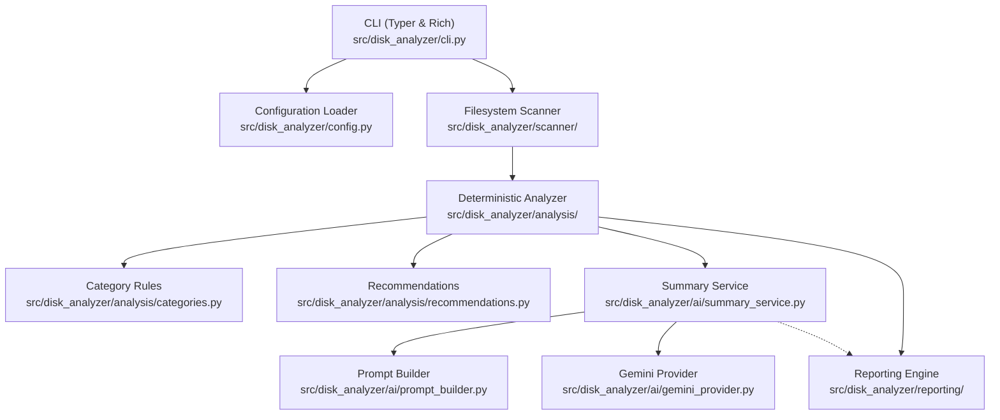

# AI Disk Analyzer Architecture

## 1. System Overview

**AI Disk Analyzer** is an intelligent, privacy-first command-line utility for Linux designed to scan filesystem directories, compute storage consumption metrics, detect heuristic storage patterns, and synthesize natural-language explanations using Google Gemini.

The application follows a strictly layered, decoupled architecture where deterministic scanning and analysis are completely independent of external AI services.

---

## 2. Core Modules

### `disk_analyzer.scanner`
- **`FilesystemScanner`**: Traverses directory subtrees recursively using `os.scandir`.
- **Inode Deduplication**: Tracks `(st_dev, st_ino)` pairs for files with hard links (`st_nlink > 1`), ensuring hard-linked files are only counted once in allocated disk usage.
- **Symlink Protection**: Does not follow symlinks by default (`follow_symlinks=False`). If enabled, maintains a set of canonical real paths to detect and break recursive loops.
- **Diagnostics**: Non-fatal filesystem errors (e.g. `PermissionError`, vanishing files, broken links) are recorded as structured `ScanDiagnostic` entries instead of terminating traversal.
- **Virtual Filesystem Filtering**: Automatically skips system virtual filesystems (`/proc`, `/sys`, `/dev`, `/run`) when scanning the root filesystem.

### `disk_analyzer.analysis`
- **`DiskAnalyzer`**: Coordinates deterministic metric computation without AI interaction. Queries overall filesystem volume metrics via `shutil.disk_usage`.
- **`categories.py`**: Classifies discovered files and directory hierarchies into recognizable patterns (e.g., Caches, Python Virtualenvs, Node Modules, Build Artifacts, Desktop Trash, Logs, VM Disks) using regex and extension rules. Assigns confidence ratings (`high`, `medium`, `low`) and marks potential cleanup candidates.
- **`recommendations.py`**: Generates evidence-based, prioritized cleanup recommendations with explicit caveats, risks, and suggested manual review steps.

### `disk_analyzer.ai`
- **`GeminiProvider`**: Encapsulates the official Google GenAI Python SDK (`google-genai`). Interacts with the `gemini-3.8-flash` model using structured JSON response enforcement (`AISummary` schema) and bounded exponential backoff for transient 429 and 5xx errors. Authentication errors (401/403) fail immediately without retrying.
- **`PromptBuilder`**: Formats compact, privacy-safe prompts containing aggregate metrics, category breakdowns, and redacted paths. Never sends file contents, usernames, environment variables, or private document paths.
- **`SummaryService`**: Orchestrates AI generation and guarantees graceful degradation. If Gemini credentials are missing, or if an API error occurs, deterministic scan and analysis results are preserved and displayed intact.

### `disk_analyzer.reporting`
- **`TerminalReporter`**: Renders rich terminal tables, progress bars, colored status badges, and formatted panels using the Rich library.
- **`JsonReporter`**: Exports a machine-readable JSON structure with stable schema keys and numeric byte values.
- **`MarkdownReporter`**: Exports documentation-friendly GitHub Flavored Markdown reports with alert callouts (`> [!NOTE]`, `> [!WARNING]`, `> [!TIP]`).

### `disk_analyzer.config`
- Loads settings with strict precedence: CLI flags > environment variables > YAML configuration > defaults.
- Always masks secrets (API keys) before printing or displaying configurations.

---

## 3. Logical Size vs. Allocated Disk Space

A core requirement of AI Disk Analyzer is distinguishing **logical file size** from **allocated disk space**:

1. **Logical File Size (`st_size`)**:
   - Represents the sequential byte length of the file data as seen by user programs.
   - For sparse files, logical size can be significantly larger than physical disk allocation.
2. **Allocated Disk Space (`st_blocks * 512`)**:
   - Represents the physical storage blocks reserved on the underlying block device by the filesystem (ext4, Btrfs, XFS, etc.).
   - Accounts for filesystem block granularity (typically 4096-byte clusters) and sparse allocation.
3. **Hard Link Accounting**:
   - When multiple directory entries point to the same filesystem inode, each entry possesses the same logical size.
   - The scanner deduplicates inodes `(st_dev, st_ino)` so allocated disk space is counted only once, preventing artificial inflation of reported totals.

